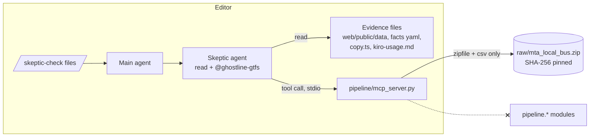

# Skeptic: Design

Status: design for review. Requirements are approved, with one addition to R9.6 (Emmanuel, Nov 22): where the "skeptic" dependency group is installed, the protocol test must run and never skip. Any skip prints a visible warning, and `python -m pipeline check` reports it. This design implements that as section 6. Nothing is built yet.

Requirement numbers (R1 to R10) refer to requirements.md.

## 1. Overview

Three parts, all editor-side. None of them ships to the site.

| Part | Files | Role |
| --- | --- | --- |
| MCP server | `pipeline/mcp_server.py` | Independent reader of the pinned feed. Two tools. |
| Kiro wiring | `.kiro/settings/mcp.json`, `.kiro/agents/skeptic.md`, `.kiro/steering/skeptic-check.md` | Starts the server, defines the read-only agent, adds `/skeptic-check`. |
| Fixtures and tests | `tests/fixtures/skeptic/{clean,planted}.md`, new test modules, small changes to `tests/conftest.py`, `pyproject.toml`, `pipeline/cli.py` | Proof that the server is correct and independent and that the agent is read-only. |



The dashed line is the rule: the server never imports `pipeline.*`. The Skeptic reaches the feed only through the server, and the repository only through `read`.

## 2. The server: pipeline/mcp_server.py

### 2.1 Layout of the one file

One module, in three layers. Only the last layer imports the SDK, and it does so inside a function. That keeps layers 1 and 2 importable and testable when the SDK is not installed (the hosted build, and a plain `pip install`), and it keeps `pytest` collection from failing there.

1. **Reader** (standard library only: `zipfile`, `csv`, `hashlib`, `datetime`, `os`, `pathlib`, `threading`, `logging`, `sys`, `dataclasses`).
2. **Queries**: `feed_info_answer(feed)` and `trips_serving_answer(feed, ...)`. Pure functions of a loaded `Feed`.
3. **Serving**: `build_server()` and `main()`. These import `mcp.server.fastmcp.FastMCP` and register the two tools.

### 2.2 Constants

```python
PINNED_SHA256 = "8cc37d54..."      # same value as pipeline.feed_check.PINNED_FEED_SHA256 (R2.2)
SERVICE_DATE = "2026-11-04"        # the one date the feed is pinned to
ENV_ZIP = "GHOSTLINE_GTFS_ZIP"
LOAD_WAIT_SECONDS = 30             # longest a tool call waits for the background load (2.5)
DEFAULT_ZIP = Path(__file__).resolve().parents[1] / "raw" / "mta_local_bus.zip"
```

`DEFAULT_ZIP` is computed from `__file__`, so it is the repository root's raw/ whatever the working directory is (R1.3). When `GHOSTLINE_GTFS_ZIP` is set to a relative path ("raw/mta_local_bus.zip", as in mcp.json), a relative value is resolved against the repository root too, not the current directory. This is the answer to brief 6.2: Kiro's working directory does not matter. R10.2 still confirms it in the IDE.

The golden values (36, 5, the five times, the stop ids 8564 and 9486, feed_version 20260821, service 2251) appear nowhere in this file (P-D). feed_version is read from the feed's feed_info.txt. The service ids are computed.

### 2.3 Data model

```python
@dataclass(frozen=True)
class Call:            # one row of stop_times for an active trip
    seq: int
    stop_id: str
    arr: int | None    # seconds after midnight, may exceed 86400
    dep: int | None
    arr_text: str      # the feed's own HH:MM:SS, kept so output is the feed's spelling
    dep_text: str

@dataclass(frozen=True)
class Trip:
    trip_id: str
    route_short_name: str
    headsign: str
    calls: tuple[Call, ...]    # sorted by seq

@dataclass
class Feed:
    error: str | None          # None means usable
    sha256: str | None
    feed_version: str | None
    active_service_ids: tuple[str, ...]
    trips: dict[str, Trip]               # active-service trips only
    by_stop: dict[str, frozenset[str]]   # stop_id -> trip_ids that call there
    stop_ids: frozenset[str]             # every stop_id in stops.txt
```

Memory: only trips of the active services on 2026-11-04 are kept, and only the five stop_times fields above. The 68 MB file is streamed row by row through `csv.DictReader` over `ZipFile.open`, and never held whole.

### 2.4 Loading (R2)

`load_feed(zip_path, expected_sha256=PINNED_SHA256) -> Feed` is the only place that touches the disk. The second argument exists so tests can use a made-up feed with a made-up hash. The tools always call it with the pinned default.

Order, failing closed at each step:

1. The zip does not exist: return `Feed(error="feed zip not found at <path>")`. Nothing is read.
2. Hash the zip in 1 MiB chunks. A mismatch returns `Feed(error="feed SHA-256 <found> does not match the pinned <pinned>")`. No table is read.
3. `feed_info.txt` gives feed_version. If the file is absent, feed_version is None (the made-up feed has none).
4. Active services for `SERVICE_DATE`, computed independently:
   - from calendar.txt: the weekday column for that date, and `start_date <= date <= end_date`;
   - then calendar_dates.txt for that date: `exception_type` 1 adds the service, 2 removes it.
   - services listed only in calendar_dates.txt (type 1) count.
5. trips.txt: keep trips whose service is active. Record route_id, headsign.
6. routes.txt: route_id to `route_short_name`, as written.
7. stops.txt: the set of stop ids (for the unknown-stop error).
8. stop_times.txt: keep rows of kept trips. Parse `stop_sequence` as int. Times are parsed from "H:MM:SS" or "HH:MM:SS" (surrounding spaces stripped) to seconds. A blank departure falls back to the arrival and a blank arrival to the departure, for the numeric value only. A call with both blank is dropped from the trip. The number of dropped calls is logged to standard error. If the real feed has any, tell Emmanuel instead of silently continuing (this is the one unknown about the real feed that the design cannot settle without reading it, so it is a check in the build task).
9. Sort each trip's calls by `seq`. Build `by_stop`.

An unreadable or malformed zip or table (missing member, missing column, bad `stop_sequence`) returns `Feed(error=...)` naming the member and the column. It never returns a partial feed.

### 2.5 Startup and the first call (R2.3, R2.4, R10.7)

Emmanuel chose reading stop_times at startup. A synchronous read before the server begins to speak could exceed Kiro's connection timeout, and that risk is R10.7. So:

- `main()` starts the loader in a background thread, then immediately starts the stdio server. The protocol handshake (initialize, tools/list) completes at once.
- The loader sets a `threading.Event` when done (success or error).
- Each tool call waits on the event, then answers from memory.
- By the time anything calls a tool, the load has normally finished, so the first call is as fast as later ones. A call that arrives during the load waits for it, and does not read the file itself.
- The wait has a limit: the module constant `LOAD_WAIT_SECONDS` (30). The tool wrappers pass it to a helper, `wait_for_feed(ready, holder, timeout=LOAD_WAIT_SECONDS)`, which calls `ready.wait(timeout)`. The `timeout` parameter exists so tests can inject a short limit. Tests never edit the constant.
- If the limit passes before the load finishes, the tool raises `FeedStillLoading`. Its text starts "feed still loading" and says how long the call waited, for example "feed still loading: waited 30 seconds for the feed to load, try again shortly".
- A tool never answers from partial data and never reads the file itself. The loader publishes the `Feed` into `holder` only when it is complete, immediately before it sets the event, so a call that times out sees nothing to answer from.

This still reads everything at startup and writes no cache, as decided. If R10.7 fails anyway on the real machine, the fallback is the synchronous read before `run()`, and Emmanuel is told first.

### 2.6 Queries (R3 to R5)

**feed_info.** Returns:

```python
{"feed_version": feed.feed_version, "sha256": feed.sha256,
 "service_date": SERVICE_DATE, "active_service_ids": list(feed.active_service_ids)}
```

If `feed.error` is set, it raises the error (below).

**trips_serving(stop_a, stop_b, date, after=None, before=None).** In this order:

1. If `feed.error`: raise it.
2. `date != SERVICE_DATE`: raise `ValueError` naming the date and the one supported date (R5.1).
3. `stop_a` or `stop_b` not in `feed.stop_ids`: raise naming the stop (R5.2). A stop that exists but has no active trips is not an error: the count is 0, and that is a true answer.
4. `after` or `before` not matching `^\d{1,2}:\d{2}$` with minutes under 60: raise naming the value (R5.3). Hours may pass 24. The limits become seconds as `H*3600 + M*60`.
5. For each trip id in `by_stop[stop_a] & by_stop[stop_b]`, walk the calls in order. At the first call at stop_a for which a later call at stop_b exists (higher `seq`), the trip counts once. `dep_a` is that call's departure. `arr_b` is the arrival of the first stop_b call after it. Later stop_a calls of the same trip are ignored (R4.3). A trip that reaches stop_b only before stop_a does not count.
6. Keep the trip if `after <= dep_seconds <= before` (each limit optional, both inclusive; R4.6).
7. Sort by `(dep_seconds, trip_id)`. Return `{"count": len(trips), "trips": [...]}` with `route_short_name` and `headsign` in the feed's own spelling and the two times as the feed's own text (R4.5, R4.8).

Sorting is by seconds, not by text, so 25:15:53 sorts after 09:00:00 and "9:00:00" sorts before "10:00:00".

If `stop_a == stop_b`: the "later call" rule makes it valid only for a trip calling there twice. It is answered by the same rule, with no special case.

### 2.7 Errors (R5.4)

Queries raise `FeedUnavailable(message)` for load errors and `ToolInputError(message)` (both `ValueError` subclasses, defined in this file) for bad input. A third `ValueError` subclass, `FeedStillLoading(message)`, is raised by `wait_for_feed` when `LOAD_WAIT_SECONDS` passes before the load finishes (2.5). Its text starts "feed still loading" and states the wait. The tool wrappers do not catch them. With FastMCP, an exception raised in a tool becomes a tool result flagged as an error whose text carries the message. The protocol test checks this on the wire, so the design does not rest on remembering how the SDK behaves. An error is never converted to `{"count": 0, "trips": []}`.

### 2.8 Serving (R1)

Written after the SDK's current documentation is checked, as R1.1 requires (the build task does this). From the current 1.x README, the shape is:

```python
def build_server(feed_ready: threading.Event, holder: dict):
    from mcp.server.fastmcp import FastMCP     # SDK import only here
    server = FastMCP("ghostline-gtfs")

    @server.tool()
    def feed_info() -> dict: ...

    @server.tool()
    def trips_serving(stop_a: str, stop_b: str, date: str,
                      after: str | None = None, before: str | None = None) -> dict: ...
    return server

def main():
    logging.basicConfig(stream=sys.stderr, level=logging.INFO)   # R1.4
    ... start loader thread ...
    build_server(...).run(transport="stdio")

if __name__ == "__main__":
    main()
```

- Nothing in the module calls `print`. Logging goes to standard error. A test (R9.5 group) scans the source for `print(` and `sys.stdout`.
- Tool docstrings state the units and limits, because the model reads them.
- No tool writes anywhere. The module opens files only for reading, and a test scans it for write modes and for `open(` with "w", "a" or "x" (R1.5).
- No `socket`, `urllib`, `http` or `requests` import (R1.6). The AST scan covers these too.

## 3. Kiro wiring (R6)

### 3.1 .kiro/settings/mcp.json

```json
{
  "mcpServers": {
    "ghostline-gtfs": {
      "command": "python",
      "args": ["-m", "pipeline.mcp_server"],
      "env": { "GHOSTLINE_GTFS_ZIP": "raw/mta_local_bus.zip" },
      "disabled": false
    }
  }
}
```

Merged, not overwritten, if the file exists (R6.1). `python` here must be the interpreter that has the "skeptic" group installed. R10.1 confirms this in the MCP Server view. If it is a different interpreter, the fix is the interpreter path in `command`, and Emmanuel is told.

### 3.2 .kiro/agents/skeptic.md

Front matter, then the instructions as the body:

```yaml
---
name: skeptic
description: Read-only fact checker for Ghost Line documents. Give it file paths; it reports every claim as OK, MISMATCH or UNSOURCED with evidence.
tools: ["read", "@ghostline-gtfs"]
---
```

The fallback `"@mcp"` (R6.4) is used only if R10.1 shows the tools are not visible. The body follows R7 section by section:

1. Role: check, never write.
2. Evidence order (R7.2) with the exact paths.
3. Output line format and the last line (R7.3, R7.7).
4. MISMATCH, UNSOURCED, matching rules, honesty rules as evidence (R7.4 to R7.6).
5. How to check a bus-trip claim: find the two stop ids from the evidence (not from memory), call `feed_info` once, then `trips_serving`, and quote the answer.
6. A claim about wording or fields (the honest line, `ride_same_rule`, `wait_most`) is checked by reading the evidence file at check time (R7.9). The body names those fields and files and holds none of their values.
7. Forbidden: edit, propose a number as fact, guess (R7.8).

A claim about a bus trip count whose stop ids cannot be found in the evidence is UNSOURCED, not guessed.

### 3.3 .kiro/steering/skeptic-check.md

Front matter `inclusion: manual`. Body: invoke the `skeptic` agent on the files named after the command, or, with none named, on docs/video_script.md and docs/devpost.md (which do not exist yet; the agent reports a missing file as an error line and does not invent a pass). Show the report unchanged. Nothing else.

## 4. Fixtures (R8)

- `tests/fixtures/skeptic/clean.md`: a short script excerpt. It holds the two required sentences (R8.1) and a small number of other claims that exist in the evidence. Each claim's evidence is chosen when the file is written, from web/public/data, and checked by reading that file at the time. The stated numbers in clean.md are not typed from memory.
- `tests/fixtures/skeptic/planted.md`: identical, except 36 becomes 38 and one sentence is added: "Ridership on the No. 21 doubled in 1938."
- Both files are free of the banned service-time words (R8.5), checked with `pipeline.check_sources.find_banned_terms`. This is a test importing the pipeline, which is allowed. Only the server must not.
- The directory is outside docs/, so the `copy-and-source-guard` hook and `check_sources` (which scans docs/*.md, web/index.html, web/src and README.md) never see it.

If a number in the two required sentences does not match the data when clean.md is written (for example the 30-minute margin), stop and tell Emmanuel. Do not change a value to fit (product.md, "When numbers disagree").

## 5. Tests (R9)

All new Python tests, grouped by what they prove. The golden values live only in `tests/golden/test_mcp_server_golden.py`.

| Module | Marker | Covers |
| --- | --- | --- |
| `tests/unit/test_mcp_server.py` | none | R9.1 on feeds built in code: a helper writes a small zip into `tmp_path` from table dictionaries, starting from tests/fixtures/fake-gtfs (calendar 2026-11-04, one removed service, so "inactive service" is already covered) and adding trips for the double call, the reversed order, the past-24:00 time and the ties. Also R5 errors, and a missing and a wrong-hash zip. Two load-wait tests drive `wait_for_feed` with an injected loader: (a) a call made during a deliberately slow load waits, then answers correctly from the finished feed; (b) a call whose wait limit passes before the load ends raises `FeedStillLoading` with text starting "feed still loading" that states the wait, and returns neither an empty list nor partial data. Both pass a short limit through the `timeout` parameter and do not edit `LOAD_WAIT_SECONDS`. |
| `tests/property/test_mcp_server_props.py` | none | R9.4, Hypothesis over small generated feeds: results sorted; count equals length; every trip has the a-call before the b-call by `seq`; widening `after`/`before` never removes a trip; a trip appears at most once; reordering the rows of stop_times does not change the answer. |
| `tests/unit/test_mcp_independence.py` | none | R2.5 and R1.5, R1.6: AST scan finds no `pipeline` import (both `import pipeline...` and `from pipeline... import`, and relative imports), no network module, no `print`, no write-mode `open`. R2.2: `PINNED_SHA256 == pipeline.feed_check.PINNED_FEED_SHA256`. R7.10: no golden token in the server, in skeptic.md or in skeptic-check.md (the stop ids and the five times). |
| `tests/unit/test_skeptic_agent.py` | none | R6.2 to R6.6: parse the front matter with PyYAML. Name is `skeptic`; tools are exactly `read` plus entries starting with `@` that name the server (or `@mcp` only as the documented fallback); neither `write` nor `shell` appears; skeptic-check.md has `inclusion: manual`; mcp.json has the entry as specified; `.gitignore` has no `.kiro` line. |
| `tests/unit/test_skeptic_fixtures.py` | none | R8.1 to R8.5: the two files differ in exactly the two places (a line diff shows one changed line, 36 to 38, and one added sentence), both required sentences are in clean.md, neither file has a banned term, neither is under docs/. |
| `tests/unit/test_mcp_protocol.py` | `needs_mcp_sdk` | R9.6 (section 6). Starts the server as a subprocess with GHOSTLINE_GTFS_ZIP pointing at a path that does not exist. Sends initialize and tools/list over stdio, and checks that every line of standard output parses as a protocol message and that both tools are listed. Then calls `feed_info` and checks the reply is an error (fail closed, on the wire). This test needs no real feed, so it also runs in `check --quick`. |
| `tests/golden/test_mcp_server_golden.py` | `requires_feed` | R9.2, R9.3. Loads the real zip with the module's own `load_feed`, and checks the golden values in the requirements. The cross-check reads `web/public/data/race/<lead pair>.json` and compares its `today.trips` departures inside 10:00 to 13:00 with the server's five. One extra golden test calls the real server over stdio with the real feed and asks for `feed_info` (the end-to-end path Kiro uses). |

Existing marker rules apply: `requires_feed` tests skip with a visible warning when raw/ is missing, through the existing `tests/conftest.py` hook, and the golden module skips itself at import with the same message (as the other golden modules do).

If a golden value differs from what the server returns, stop and tell Emmanuel (P-D).

## 6. Protocol test: never skipped where the SDK is installed (R9.6 addition)

Policy: the test skips only when the SDK is absent. If the SDK is present, nothing may make it skip.

**Marker.** A new marker `needs_mcp_sdk` is registered in pyproject.toml, next to `requires_feed` and `timing`.

**Skip condition.** In `tests/conftest.py`, a collection hook tests `importlib.util.find_spec("mcp") is None`, not `ImportError` on `import mcp`. The consequence is intended:

- SDK absent: items marked `needs_mcp_sdk` get a skip marker with the reason "the MCP SDK is not installed: protocol test SKIPPED (pip install -e .[skeptic])". The hook also calls `warnings.warn(...)` with the count and the same reason, exactly as the feed hook does.
- SDK present but broken (it imports with an error): the test runs and fails with the real error. A broken install is not hidden as a skip.

**Guard against any other skip.** A `pytest_runtest_logreport` hook records the node ids of `needs_mcp_sdk` tests whose outcome is `skipped`. A `pytest_sessionfinish` hook, if the SDK is installed and that list is not empty, prints the list and sets `session.exitstatus = 1`. So if someone adds `pytest.skip`, `skipif` or `xfail`-style logic to the test later, the run fails on Emmanuel's machine. A deselected test (a `-k` filter, or `-m` filtering) is not counted, since it was not skipped.

**Reporting in `python -m pipeline check`.** `run_check` and `run_check_quick` in `pipeline/cli.py` use a small helper, `mcp_sdk_line()`, which returns one of two lines from `importlib.util.find_spec("mcp")`:

- installed: `check: MCP SDK installed: the protocol test will run`;
- absent: `check: WARNING: MCP SDK not installed: the protocol test will be SKIPPED (pip install -e .[skeptic])`.

The line is said before pytest starts and said again after "pytest exited with N", so a long run does not bury it. The exit code does not change when the SDK is absent: the hosted build must still pass. `QUICK_PYTEST_ARGS`, the pytest argument lists and the `runner` interface are unchanged, so the existing tests of `run_check` keep working. New tests cover the helper and the two outputs with an injected `say` and a patched `find_spec`.

`check --timing` runs only timing tests and does not print the line.

## 7. Dependency (R1.7, R1.8)

pyproject.toml gains, next to `dev`:

```toml
skeptic = ["mcp>=1.27,<2"]
```

Install with `pip install -e .[skeptic]`, after Emmanuel's go-ahead given immediately before the command runs (R1.8). Version 2 is in alpha and excluded by the bound. Afterwards: `python -c "import mcp"` on this machine, as the check that the SDK imports on Python 3.14 (the SDK's classifiers stop at 3.13).

The hosted build installs neither the group nor needs it.

## 8. Requirement coverage

| Requirement | Where designed |
| --- | --- |
| R1.1 to R1.6 | 2.1, 2.2, 2.8 |
| R1.7, R1.8 | 7 |
| R2.1, R2.5 | 2.1, 5 (test_mcp_independence) |
| R2.2 | 2.2, 5 |
| R2.3, R2.4 | 2.4, 2.5 |
| R3 | 2.6 |
| R4 | 2.3, 2.6 |
| R5 | 2.6, 2.7 |
| Load-wait limit (design-level addition to R2.4 and R5.4, approved by Emmanuel) | 2.2, 2.5, 2.7, 5 (test_mcp_server) |
| R6.1 | 3.1 |
| R6.2 to R6.5 | 3.2, 3.3, 5 (test_skeptic_agent) |
| R6.6 | 5 (test_skeptic_agent) |
| R7 | 3.2 |
| R8 | 4, 5 (test_skeptic_fixtures) |
| R9.1 to R9.5 | 5 |
| R9.6 and the addition | 5, 6 |
| R9.7 | 6 (existing arguments unchanged), checked in the final task |
| R10 | Not designed. Written as steps in tasks.md and left unchecked for Emmanuel. |

## 9. Risks and unknowns

1. **Blank times in the real stop_times.** Handled by the rule in 2.4 step 8. The build task reports the count of dropped calls on the real feed. A non-zero count goes to Emmanuel.
2. **Kiro's connection timeout during the load.** Reduced by the background load (2.5). R10.7 confirms it.
3. **Which `python` Kiro starts.** It must be the interpreter with the SDK (3.1). R10.1 confirms it.
4. **`@ghostline-gtfs` may not expose the tools** (brief 6.1). Fallback `"@mcp"`, nothing else widened (R6.4).
5. **SDK on Python 3.14.** Unconfirmed by its classifiers. The import check in section 7 settles it. If it fails, stop and tell Emmanuel. The choice then is a different interpreter for the server or a later SDK release.
6. **Exceptions as tool errors.** Believed to become error results in FastMCP. The protocol test proves it on the wire. If it does not, the wrapper is changed to return the SDK's error result, and the contract in R5.4 stays the same.
7. **Hooks.** `rebuild-and-test-when-agent-stops` runs `python -m pipeline check`, which now includes these tests. The protocol test starts one short subprocess and adds about a second. The server tests need no real feed except the golden module, which already follows the feed-present rule.
8. **Evidence for clean.md.** Its claims are written against the data files as they are at the time. A later data change (race-2 in Phase 3) needs clean.md re-checked. This is the point of the fixture.

## Document map

The headings below exist so the document has the standard section names. They only point to the numbered sections above and add no requirements. The numbered sections keep their numbers because other documents cite them.

## Overview

See section 1 (Overview).

## Architecture

See the diagram and the part table in section 1.

## Components and Interfaces

See section 2 (the server and its two tools) and section 3 (the Kiro wiring).

## Data Models

See section 2.3 (Call, Trip and Feed).

## Correctness Properties

These are the properties already stated in section 5 (`tests/property/test_mcp_server_props.py`, R9.4). Each is tested over small generated feeds.

### Property 1: Results are sorted and counted

For any generated feed, the `trips_serving` results are sorted by departure seconds and then trip id, and `count` equals the length of `trips`.

**Validates: Requirements 9.4**

### Property 2: Boarding comes before alighting

For any generated feed, every returned trip has its stop_a call before its stop_b call by `seq`.

**Validates: Requirements 9.4**

### Property 3: Widening the window never removes a trip

For any generated feed, widening `after` or `before` never removes a trip.

**Validates: Requirements 9.4**

### Property 4: No trip appears twice

For any generated feed, a trip appears at most once.

**Validates: Requirements 9.4**

### Property 5: Row order does not matter

For any generated feed, reordering the rows of stop_times does not change the answer.

**Validates: Requirements 9.4**

## Error Handling

See section 2.7 (errors), section 2.4 (load failures) and section 2.5 (the load-wait limit). The requirement is R5.

## Testing Strategy

See section 5 (tests) and section 6 (the protocol test that never skips where the SDK is installed).
