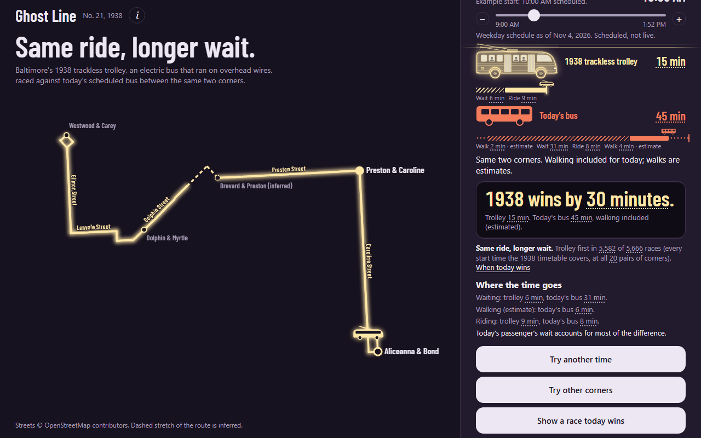

# Ghost Line

**Same ride, longer wait.** Baltimore's 1938 No. 21 trackless trolley, raced against today's scheduled bus between the same two corners, walking included.

**Site:** https://optimistic-max.github.io/Ghost-Line/ · Kiroween 2026, Resurrection category



## What it does

1. Open the page. A race starts by itself: Preston & Caroline to Aliceanna & Bond, at the labelled example start, 10:00 AM scheduled.
2. Drag the time from 9:00 AM to 1:52 PM. Both riders leave the corner at that minute; each vehicle leaves at its own scheduled time.
3. Pick any two of the line's five timing corners, or swap direction.
4. Tap any number to see where it comes from.

Each race ends in one of four results: **1938 wins**, **Today wins**, **Photo finish** (under a minute apart) or **No one-seat ride today**. A win for today looks exactly like a win for 1938.

## What it found

For this one line, at 20 pairs of corners. Each pair is raced at every minute from its first covered minute to 1:52 PM.

| | |
|---|---|
| Scheduled races | 5,666 |
| 1938 wins | 5,582 |
| Today wins | 25 |
| Photo finishes | 59 |
| Pairs where the ride itself is about the same length | 17 of 20 |
| Pairs where today's ride is faster | 3 of 20 |

These counts cover this line's 20 corner pairs only. They are read from `web/public/data/summary.json`, which the pipeline writes.

## How a race works

- **Start.** Both sides start at the chosen minute, or at the first listed 1938 car at the origin corner if that is later. The 1938 guide lists midday cars only, so before the first listed car the page says so and races from that car's time.
- **1938.** The next listed car at or after the start. Wait plus ride. No walk.
- **Today.** Among one-seat bus trips the rider can still reach after walking to a stop within 400 m of the corner, the trip that reaches the destination corner first, walking included. Walk time is an estimate: straight-line metres times 1.3 for street detours, at 1.2 m/s.
- **Result.** Totals less than 1.0 minute apart are a photo finish, because the walks are estimates.

Today's side is one frozen snapshot: the weekday schedule for Wednesday, November 4, 2026. Scheduled, not live.

## Why 1938

This guide lists the No. 21's cars minute by minute, with running times between corners. We use only its midday cars and don't claim 1938 was typical.

## What it does not claim

- It compares **scheduled** service on one weekday. It says nothing about delays.
- It counts **one-seat rides** only. Today's side counts only trips with no transfer, from a stop within 400 m of each corner. A rider who changes buses, or rides part way and walks, may do better; Ghost Line does not model that.
- Results hold for these corners in this direction. They are not a claim about every trip on today's routes.
- One corner, Brevard & Preston, is **inferred**: its exact position is unresolved. It is drawn dashed, tagged "inferred", and is never the default.
- It does not say why service changed, or who rode the line in 1938.

## Sources

| What | Where | Notes |
|---|---|---|
| 1938 route, running minutes and timetable | [No. 21 guide, effective March 6, 1938](https://collections.digitalmaryland.org/digital/collection/btjk/id/203), Digital Maryland | Entered by hand in `data/lines/no21-1938.yaml`, each value with its page link. Scans are linked, not copied. |
| Today's schedule | MDOT MTA local bus GTFS, feed version 20260821 | Pinned by SHA-256 `8cc37d54d3a360979a6bcc70038b6f532a1e6475041ad970bdaafde34ab3f694`. Not endorsed by MDOT MTA. |
| Street shapes | OpenStreetMap, snapshot dated 2026-11-01 in `data/osm/ways.json` | © OpenStreetMap contributors, ODbL. |

The 1938 running minutes and midday departures were checked by hand against the scans.

## Run it yourself

You need Python 3.12 or later and Node.js.

```
pip install -e ".[dev]"
```

```
python -m pipeline validate
```

`validate` runs the fast checks and does not read the schedule file.

The folder `raw/` is git-ignored, so the pinned schedule file `raw/mta_local_bus.zip` is not in this repository. Feed version 20260821 has the SHA-256 shown above. Get the file from https://feeds.mta.maryland.gov/gtfs/local-bus if the MTA still serves that version. The build never downloads it, and stops with an error if the file is missing or its SHA-256 differs. Without it you can still run `validate`, the site and the tests that don't need the feed; golden tests skip with a message.

```
python -m pipeline build
```

```
python -m pipeline verify
```

`verify` rebuilds from `raw/` and fails if the committed data files differ.

To run the site:

```
npm install --prefix web
```

```
npm run dev --prefix web
```

## How it is built

- `pipeline/`: Python. Does all the arithmetic once and writes JSON into `web/public/data/`.
- `web/`: TypeScript, no UI framework. Looks numbers up, rounds them for display and animates. No race arithmetic runs in the browser.
- `data/lines/`: the hand-entered 1938 facts.
- `tests/`: example tests, golden tests on the pinned feed, and property-based tests.

No AI model runs in the deployed app.

## How Kiro was used

Built with [Kiro](https://kiro.dev) for Kiroween 2026 by Emmanuel Chukwuemeka, a student, working alone.

| Kiro feature | Where |
|---|---|
| Specs (requirements, design, tasks) | [`.kiro/specs`](.kiro/specs) |
| Steering (rules that always apply) | [`.kiro/steering`](.kiro/steering) |
| Hooks (checks that run in the editor) | [`.kiro/hooks`](.kiro/hooks) |
| Read-only fact-checking agent | [`.kiro/agents/skeptic.md`](.kiro/agents/skeptic.md) |
| MCP server settings | [`.kiro/settings/mcp.json`](.kiro/settings/mcp.json) |
| MCP server code, an independent GTFS reader | [`pipeline/mcp_server.py`](pipeline/mcp_server.py) |
| Full log of what Kiro did | [`docs/kiro-usage.md`](docs/kiro-usage.md) |

Kiro hooks, agents and MCP tools run only in the editor.

### Run the Skeptic

In Kiro chat, type `/skeptic-check <file>`, for example `/skeptic-check docs/devpost.md`. The Skeptic agent reads the file and the repo's evidence, then reports each claim as OK, MISMATCH or UNSOURCED, and ends with PASS or FAIL. It never edits files.

### Who prepared what

Facts files, the OpenStreetMap way snapshot, planning briefs, mockup pictures and expected test values were prepared during planning with Claude Code and Codex. The pipeline and the app were built in Kiro.

## Licence

Code: MIT, see [LICENSE](LICENSE). Route geometry derived from OpenStreetMap is under the ODbL. 1938 scans are linked from Digital Maryland, not copied. MDOT MTA data is credited, uses no logos, and is not endorsed by MDOT MTA.
